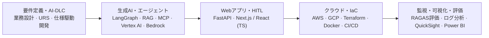

# あぶどら・まもん（工学博士 / PMP）

**シニア生成AI・LLMエンジニア ／ フォワードデプロイドエンジニア（FDE） ／ クラウド・データアーキテクト**

[-2ea44f?style=flat-square)](#)

[%20%7C%20英語(TOEIC%20850)-6f42c1?style=flat-square)](#)

> 🌐 **[English Profile (README.md)](./README.md)**

---

## 概要

**10年以上のデータエンジニアリング・BIコンサルティング・クラウド基盤構築**の経験をベースに、2023年以降は**生成AI・RAG・マルチエージェントシステムの本番構築**をFDE（Forward Deployed Engineer）／テックリードとして一貫して推進しています。

事業課題の整理・要件定義（URS）から、LLM/AIエージェント開発、AWS・GCPインフラのTerraform化、本番ログの可視化・精度改善まで一気通貫で担当します。

---

## 主な実務実績（守秘義務の範囲内で記載）

- **GCP上のAI中心アーキテクチャ・マルチエージェント基盤（2026年）:** 既存業務のAIシフトを技術リードとして推進。Human-in-the-Loop（HITL）設計、提案書自動チェック・Deep Researchマルチエージェント（Vertex AI Agent Builder / Copilot Studio）、Python（FastAPI）× Cloud Run / Cloud Tasks / Cloud SQL の構築およびTerraform化、AI-DLC（仕様駆動開発）の導入を実施。
- **AWS RAG基盤・データパイプライン自動化・観測性構築（2025年）:** `Lambda → Amazon Bedrock → OpenSearch → S3` のナレッジベースRAG構築・精度改善、チャットボットログの自動分析基盤（`ECS → FireLens → S3 → Glue → Athena → QuickSight → EventBridge/Lambda`）のTerraform／CloudFormation化、Difyサーバ運用、Figma Dev Mode + MCPによるコード自動生成PoCを実施。
- **製薬企業向け生成AI業務自動化・PM（2024〜2025年）:** 治験関連文書（CTD・IB等）の自動作成・整合性確認システムにて要件定義書・URS作成、概算見積、海外オフショア（ベトナム）マネジメント、およびDify/n8nによるRAG・ワークフロー構築を推進。
- **データエンジニアリング・BI・CPS／ML（2012〜2023年）:** 製造・物流・営業領域でのビッグデータ加工・LTV分析・Power BI可視化コンサル（10年）、Azure上のCyber Physical System（CPS）設計およびPyTorch/TensorFlow・Databricksを用いたEVバッテリーEOL予測モデル構築。

---

## 保有技術スタック

| 領域 | 主な技術・ツール |
|---|---|
| **生成AI・エージェント** | LLMアプリ開発、RAG（埋め込み・ハイブリッド検索・精度改善・RAGAS）、マルチエージェント、HITL、LangChain、LangGraph、MCPサーバー連携、Dify、n8n |
| **AIプラットフォーム** | Amazon Bedrock、Google Vertex AI（Gemini / Agent Builder）、Azure OpenAI、Microsoft Copilot Studio、Amazon OpenSearch |
| **アプリ開発** | Python（FastAPI）、TypeScript、React、Next.js（App Router）、REST API、Docker、Linux、GitHub Actions CI/CD |
| **クラウド・IaC** | AWS（Lambda, ECS, S3, OpenSearch, Glue, Athena, EventBridge, Aurora, QuickSight）、GCP（Cloud Run, Cloud Tasks, Cloud SQL, BigQuery, Vertex AI）、Azure、Terraform、CloudFormation |
| **データ・ML・BI** | SQL（PostgreSQL, Aurora, MySQL, Azure SQL）、PyTorch、TensorFlow、Databricks、Polars/Pandas、Knime、Amazon QuickSight、Power BI |
| **AI駆動開発（AI-DLC）** | Claude Code、Cursor、Gemini CLI、Amazon Q、仕様駆動開発、Figma Dev Mode + MCP |

---

## 公開リファレンスアーキテクチャ（順次公開中）

実務案件は守秘義務対象のため、同等の本番設計パターンを再現可能なオープンソース・リファレンス実装として公開しています。

| リポジトリ | テーマ | 主なスタック | ステータス |
|---|---|---|---|
| [`ai-dlc-spec-driven-starter`](https://github.com/mabdullah-ml/ai-dlc-spec-driven-starter) | AI-DLC仕様駆動開発テンプレート＆PR仕様チェック自動化 | GitHub Actions, Claude Code, Cursor | ✅ 公開中 |
| [`mcp-enterprise-data-suite`](https://github.com/mabdullah-ml/mcp-enterprise-data-suite) | セキュリティガードレール付きエンタープライズMCPサーバー群 | Python (FastAPI), TypeScript, pgvector | ✅ 公開中 |
| [`gcp-multi-agent-hitl-platform`](https://github.com/mabdullah-ml/gcp-multi-agent-hitl-platform) | GCPマルチエージェント Deep Research & HITL承認基盤 | FastAPI, LangGraph, Vertex AI, Next.js, Terraform | ✅ 公開中 |
| [`aws-bedrock-rag-eval-workbench`](https://github.com/mabdullah-ml/aws-bedrock-rag-eval-workbench) | AWS Bedrock RAG構築＆RAGAS自動精度評価ベンチマーク | Bedrock, OpenSearch, Lambda, RAGAS, Terraform | ✅ 公開中 |
| [`llm-observability-aws-pipeline`](https://github.com/mabdullah-ml/llm-observability-aws-pipeline) | チャットボットログ分析・コスト/品質可視化パイプライン（IaC） | ECS, FireLens, S3, Glue, Athena, Terraform | ✅ 公開中 |
| [`clinical-doc-compliance-agent`](https://github.com/mabdullah-ml/clinical-doc-compliance-agent) | 規制文書ドラフト作成＆文書間整合性チェックエージェント | FastAPI, LangGraph, Pydantic, Next.js | ✅ 公開中 |
| [`dify-n8n-production-aws-kit`](https://github.com/mabdullah-ml/dify-n8n-production-aws-kit) | AWS本番Dify・n8n構築Terraform＆業務ワークフロー集 | Terraform, AWS, Docker, Dify DSL, n8n | ✅ 公開中 |
| [`figma-mcp-design-to-code-kit`](https://github.com/mabdullah-ml/figma-mcp-design-to-code-kit) | Figma Dev Mode + MCP → Next.js自動生成・E2E検証 | TypeScript, Next.js, Tailwind, Playwright | ✅ 公開中 |
| [`ev-battery-eol-cps-mlops`](https://github.com/mabdullah-ml/ev-battery-eol-cps-mlops) | CPSテレメトリ＆EVバッテリー寿命（EOL/RUL）予測ML | PyTorch, MLflow, FastAPI, Docker | ✅ 公開中 |
| [`enterprise-lakehouse-clv-inventory`](https://github.com/mabdullah-ml/enterprise-lakehouse-clv-inventory) | 製造品質・顧客LTV分析＆在庫自動発注ELTデータ基盤 | Python (Polars), dbt, PostgreSQL, DuckDB | ✅ 公開中 |

---

## 学位・資格・連絡先

- **学歴:** 情報システム工学 博士課程修了（工学博士 / Ph.D.）
- **資格:** PMP（Project Management Professional）・データサイエンティスト資格・TOEIC 850点
- **LinkedIn:** [linkedin.com/in/mamunabdullah01](https://www.linkedin.com/in/mamunabdullah01)
- **Email:** [mamun01117@gmail.com](mailto:mamun01117@gmail.com)
