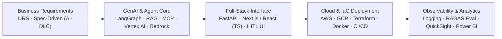

# Abdullah Mamun, Ph.D.

**Senior Generative AI / LLM Engineer · Forward-Deployed AI Engineer (FDE) · Cloud & Data Architect**

[-2ea44f?style=flat-square)](#)

[%20%7C%20Japanese%20(Native)-6f42c1?style=flat-square)](#)
[-f59e0b?style=flat-square)](#)

> 🌐 **[日本語版プロフィールはこちら (README.ja.md)](./README.ja.md)**

---

## About Me

I design and ship **production Generative AI, RAG, and Multi-Agent systems**, built on top of **10+ years of enterprise data engineering, BI consulting, and cloud architecture** across AWS, GCP, and Azure.

I own the entire lifecycle—from business requirements and architecture design to LLM/Agent implementation, Terraform Infrastructure-as-Code, and production observability dashboards.

---

## Production Experience Highlights

- **AI-Centric Architecture & Multi-Agent HITL (GCP):** Led AI transformation of enterprise business workflows; engineered autonomous multi-agent research & proposal-verification systems with Human-in-the-Loop (HITL) oversight using FastAPI on Cloud Run, Cloud Tasks, Cloud SQL, Vertex AI (Gemini), and Terraform.
- **Enterprise RAG & Retrieval Tuning (AWS / Azure):** Built production knowledge-base RAG pipelines (`Lambda → Amazon Bedrock → Amazon OpenSearch → S3` and Azure OpenAI + LangChain/LangGraph), driving measurable retrieval-accuracy improvements and citation-backed Q&A.
- **LLM Observability & Automated Data Pipelines:** Automated end-to-end chatbot telemetry and executive reporting pipelines (`ECS → FireLens → S3 → Glue Crawler → Athena → QuickSight → EventBridge/Lambda`) codified with Terraform and CloudFormation.
- **Regulated Document Automation (Pharmaceutical):** Served as PM & Solution Lead automating clinical-trial document drafting and cross-document consistency verification (CTD / Investigator's Brochure), including URS authoring and offshore team management.
- **Rapid AI Delivery & Design-to-Code:** Hosted and operated Dify/n8n workflows on AWS for AI-commerce and internal ops; implemented `Figma Dev Mode + MCP` design-to-React/Next.js automation and spec-driven AI-DLC practices with Claude Code, Cursor, and Gemini CLI.
- **Data Engineering, CPS & Predictive ML (10+ Years):** Delivered large-scale ETL, PostgreSQL/Aurora/Azure SQL data platforms, Power BI executive dashboards (manufacturing, logistics, sales LTV), and Azure Cyber-Physical System (CPS) + PyTorch/TensorFlow EV battery End-of-Life (EOL) prediction models.

---

## Core Technical Stack

| Domain | Technologies |
|---|---|
| **Generative AI & Agents** | LLM Apps, RAG (Embeddings, Hybrid Search, Accuracy Tuning, RAGAS), Multi-Agent Systems, HITL, LangChain, LangGraph, MCP (Model Context Protocol), Dify, n8n, Prompt Engineering |
| **LLM Platforms** | Amazon Bedrock, Google Vertex AI (Gemini / Agent Builder), Azure OpenAI, Microsoft Copilot Studio, Amazon OpenSearch |
| **Backend & Frontend** | Python (FastAPI), TypeScript, React, Next.js (App Router), REST APIs, Docker, Linux, GitHub Actions CI/CD |
| **Cloud & IaC** | AWS (Lambda, ECS, S3, OpenSearch, Glue, Athena, EventBridge, Aurora, QuickSight), GCP (Cloud Run, Cloud Tasks, Cloud SQL, BigQuery, Vertex AI), Azure, Terraform, CloudFormation |
| **Data, ML & BI** | SQL (PostgreSQL, Aurora, MySQL, Azure SQL), PyTorch, TensorFlow, Databricks, Polars/Pandas, Knime, Amazon QuickSight, Power BI |
| **AI-Assisted Engineering** | Claude Code, Cursor, Gemini CLI, Amazon Q, Spec-Driven Development (AI-DLC), Figma Dev Mode + MCP |

---

## Open-Source Reference Architecture Portfolio

Because client engagements are under NDA, I publish clean, reproducible open-source reference implementations demonstrating the production patterns I build:

| Repository | Focus Area | Key Stack | Status |
|---|---|---|---|
| `ai-dlc-spec-driven-starter` | Spec-Driven AI-DLC Playbook & Automated PR Spec Reviewer | GitHub Actions, Claude Code, Cursor, Python/TS | 🚧 Building |
| `mcp-enterprise-data-suite` | Production MCP Servers (SQL Guardrails, Vector KB, API Bridge) | Python (FastMCP), TypeScript, pgvector, Docker | 🚧 Building |
| [`gcp-multi-agent-hitl-platform`](https://github.com/mabdullah-ml/gcp-multi-agent-hitl-platform) | Multi-Agent Deep Research & Proposal Audit with HITL | FastAPI, LangGraph, Vertex AI, Next.js, Terraform | ✅ Live |
| `aws-bedrock-rag-eval-workbench` | Enterprise AWS RAG + Automated RAGAS Accuracy Benchmarks | Bedrock, OpenSearch, Lambda, RAGAS, Terraform | 📋 Planned |
| `llm-observability-aws-pipeline` | Chatbot Telemetry, Token-Cost & Quality Observability IaC | ECS, FireLens, S3, Glue, Athena, Terraform | 📋 Planned |
| `clinical-doc-compliance-agent` | Regulated Document Drafting & Cross-Doc Consistency Agent | FastAPI, LangGraph, Pydantic, Next.js, Docker | 📋 Planned |
| `dify-n8n-production-aws-kit` | Self-Hosted Dify & n8n on AWS + Enterprise Workflow Blueprints | Terraform, AWS, Docker, Dify DSL, n8n JSON | 📋 Planned |
| `figma-mcp-design-to-code-kit` | Figma Dev Mode + MCP → Typed Next.js Component Pipeline | TypeScript, Next.js, Tailwind, Vitest, Playwright | 📋 Planned |
| `ev-battery-eol-cps-mlops` | CPS IoT Telemetry & EV Battery End-of-Life (RUL) Prediction | PyTorch, MLflow, FastAPI, TimescaleDB, Docker | 📋 Planned |
| `enterprise-lakehouse-clv-inventory` | Manufacturing Quality, Customer LTV & Auto-Reorder ELT Stack | Python (Polars), dbt, PostgreSQL, DuckDB, BI | 📋 Planned |

---

## Credentials & Contact

- **Education:** Ph.D. (Doctor of Engineering) in Information Systems Engineering
- **Certifications:** PMP (Project Management Professional) · Data Scientist Certification · TOEIC 850
- **LinkedIn:** [linkedin.com/in/mamunabdullah01](https://www.linkedin.com/in/mamunabdullah01)
- **Email:** [mamun01117@gmail.com](mailto:mamun01117@gmail.com)
- **Location & Overlap:** Tokyo, Japan (`JST / UTC+9`) — flexible overlap with US, EU/UK, and APAC teams.
